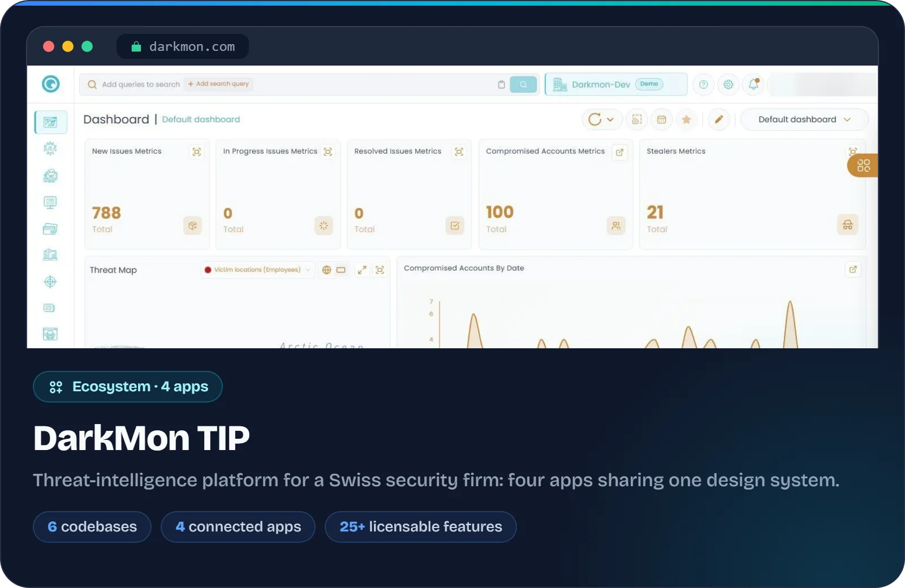
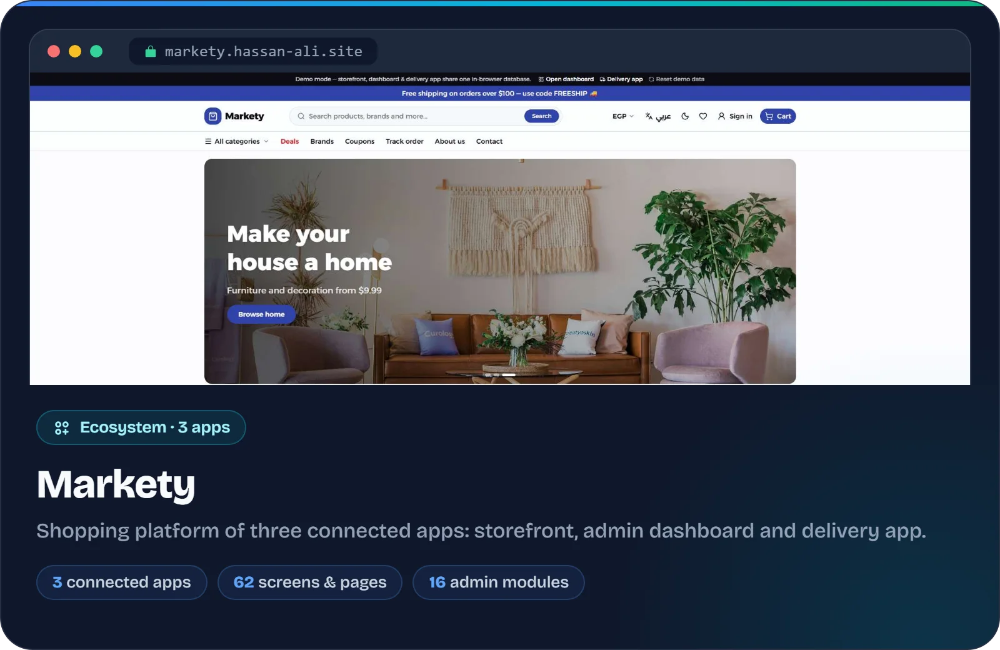
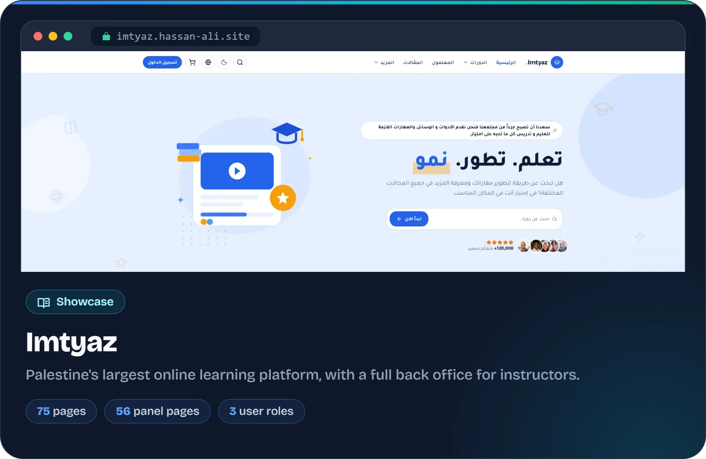
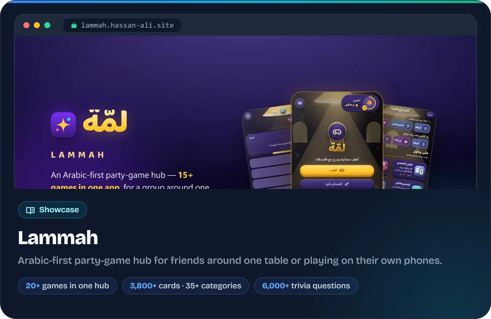
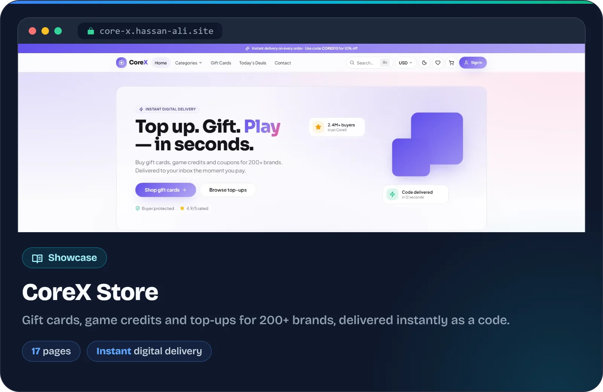
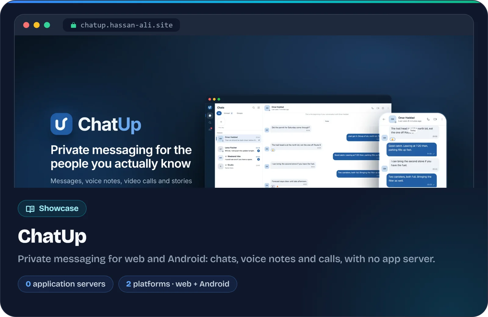
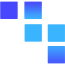
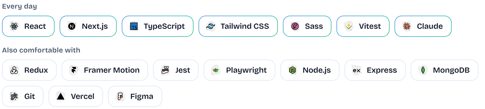

<a href="https://hassan-ali.site">
  <picture>
    <source media="(prefers-color-scheme: dark)" srcset="assets/header-dark.svg">
    
  </picture>
</a>

  <a href="https://hassan-ali.site"><picture><source media="(prefers-color-scheme: dark)" srcset="assets/links/portfolio-dark.svg"></picture></a>
  <a href="https://hassan-ali.site/recruiter"><picture><source media="(prefers-color-scheme: dark)" srcset="assets/links/recruiter-dark.svg"></picture></a>
  <a href="https://hassan-ali.site/resume"><picture><source media="(prefers-color-scheme: dark)" srcset="assets/links/resume-dark.svg"></picture></a>
  <a href="https://www.linkedin.com/in/hassan1998"><picture><source media="(prefers-color-scheme: dark)" srcset="assets/links/linkedin-dark.svg"></picture></a>
  <a href="mailto:7assan.3li1998@gmail.com"><picture><source media="(prefers-color-scheme: dark)" srcset="assets/links/email-dark.svg"></picture></a>
  <a href="https://hassan-ali.site/ar"><picture><source media="(prefers-color-scheme: dark)" srcset="assets/links/arabic-dark.svg"></picture></a>

## About

I'm a self-taught frontend engineer from Egypt who turns complex products into interfaces people enjoy using. Since 2021 I've shipped 39+ projects, from a threat-intelligence platform for a Swiss security firm to e-learning platforms, online stores and an Arabic party-game hub, plus 12 premium templates on ThemeForest.

- **Now:** Frontend Developer at **DarkMon**, building the four apps of its threat-intelligence platform.
- **Focus:** fast, accessible interfaces with React, Next.js and TypeScript, shared design systems, and full Arabic right-to-left support.
- **Open to:** full-time frontend roles and freelance projects.

## Featured work

  
  

  
  

  
  

<a href="https://hassan-ali.site/projects"><b>See all 39 projects on hassan-ali.site →</b></a>

## Experience

| | Role | Highlights | When |
| :---: | --- | --- | --- |
|  | **Frontend Developer** [DarkMon](https://darkmon.com) | Four apps of an enterprise threat-intelligence platform across six codebases, on one shared design system | Sep 2024 – Present |
|  | **Front End Developer** [GridsApps](https://gridsapps.com) | Multi-language client platforms with full Arabic right-to-left support, including Hawas, Dorosak and Afiyetcom | Oct 2023 – Sep 2024 |
|  | **Front End Developer** [ThemesCamp](https://themescamp.com) | Premium website templates published on ThemeForest | Apr 2022 – Oct 2023 |

## Stack

<picture>
  <source media="(prefers-color-scheme: dark)" srcset="assets/stack-dark.webp">
  
</picture>

## Let's work together

Hiring for a frontend role or planning a project? Email me at **[7assan.3li1998@gmail.com](mailto:7assan.3li1998@gmail.com)**, or get the whole picture in the [60-second profile](https://hassan-ali.site/recruiter).

الموقع متاح بالعربية أيضًا: <a href="https://hassan-ali.site/ar">hassan-ali.site/ar</a>

